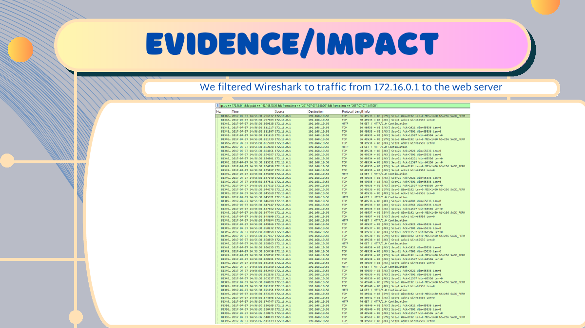
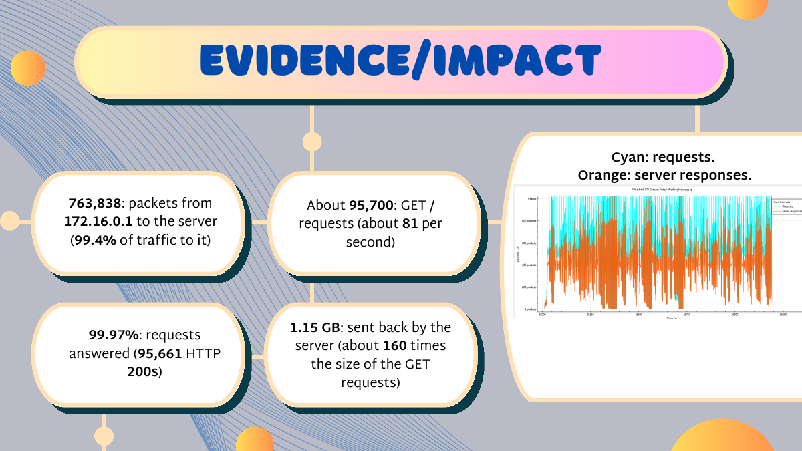

# CICIDS2017 Friday DDoS: Incident Analysis (Wireshark + Splunk)

A team incident-analysis project for the CodePath CYB102 capstone. We investigated the Friday, July 7, 2017 DDoS traffic in the [CICIDS2017](https://www.unb.ca/cic/datasets/ids-2017.html) dataset and followed the [CERT Société Générale IRM-4 (DDoS)](https://github.com/certsocietegenerale/IRM) incident response playbook.

## Summary

For about 20 minutes, a public-facing Ubuntu web server (`192.168.10.50`, TCP 80) was hit by an **HTTP GET flood**: completed connections, each requesting `GET / HTTP/1.0`, repeated about 81 times per second. The server **stayed up but degraded**. It answered 99.97% of requests, but response times grew from about 1 ms to over a second. All of the traffic appeared to come from **`172.16.0.1`, the firewall's NAT address**, which hides the real attackers and also carries legitimate users. Blocking it blindly would cut off real users.

## Key findings

| Measure | Value | Source |
|---|---|---|
| Capture analyzed | `Friday-WorkingHours.pcap`, 9,997,874 packets, 07:59:39 to 16:02:41 | Wireshark |
| Attack window | 14:56:31 to 15:16:10 (Wireshark time), listed as 3:56 to 4:16 PM in the dataset | Wireshark / Splunk |
| DDoS-labeled flows to the server | 128,024 | Splunk (CSV) |
| Peak flows per minute | 8,244 at 3:57 PM (dataset time) | Splunk (CSV) |
| `GET /` requests | 95,685 (about 81 per second) | Wireshark |
| Requests answered with HTTP 200 | 95,661 (99.97%) | Wireshark |
| Packets from 172.16.0.1 to the server | 763,838 (99.4% of packets to the server in the window) | Wireshark Endpoints |
| Data sent back by the server | about 1.15 GB (about 160x the size of the GET request packets) | Wireshark |
| Server response time | about 1 ms at the start, over 1 second within seconds | Wireshark |

## What's in this repo

| Path | Contents |
|---|---|
| [`report/incident-report.md`](report/incident-report.md) | Full incident write-up: timeline, triage, impact, analysis, remediation, limits |
| [`wireshark/filters.md`](wireshark/filters.md) | Every display filter and Wireshark step used, with the result each produced |
| [`splunk/`](splunk) | The SPL query and results for flows per minute |
| [`case-management/DATA-DIG-001.md`](case-management/DATA-DIG-001.md) | The incident ticket we logged in a local Catalyst instance |
| [`presentation/`](presentation) | Our slide deck (PDF) and slide images |

## How to reproduce

1. Download the Friday PCAP from the [CICIDS2017 page](https://www.unb.ca/cic/datasets/ids-2017.html). It is about 8.8 GB, so it is not included in this repo.
2. Confirm you have the same file:
   - SHA-256: `beff0dcce1eebc9b2454582f4dc8ed0ba0112b2c619a710bf03af93147254cd0`
   - SHA-1: `8b2f8cb9dd618a40f614aef197317af0d611439f`
3. Open it in Wireshark and follow [`wireshark/filters.md`](wireshark/filters.md).
4. For the flow analysis, load the matching flow CSVs into Splunk and run [`splunk/query.spl`](splunk/query.spl).

## Limits

- **No server logs or uptime data.** We can say the server responded to nearly everything, but not what real users experienced.
- **One-hour clock offset.** Wireshark shows the attack at 14:56 to 15:16. The dataset lists 3:56 to 4:16 PM. Splunk's per-minute counts support treating them as the same attack.
- **Flows are not requests.** Splunk counts 128,024 flows and Wireshark counts about 95,700 HTTP requests. They are different units, and we have not verified exactly why the numbers differ.
- **Duplicate packets.** The capture contains duplicate-packet artifacts, so TCP retransmission counts are not reliable evidence here. We relied on answered-request counts and response times instead.
- **Attackers are masked by NAT.** We cannot see the real source machines from this capture.
- **Recommendations are proposals.** This is historical data, so nothing in the remediation section was implemented or tested.

## Team

CodePath CYB102 capstone team: Frabina, Hamid, Angela, and Christopher Diaz. Splunk/CSV analysis was led by Frabina and Angela. Wireshark/PCAP analysis was led by Christopher and Hamid.

## Dataset and references

- Sharafaldin, I., Lashkari, A. H., & Ghorbani, A. A. (2018). *Toward Generating a New Intrusion Detection Dataset and Intrusion Traffic Characterization.* ICISSP. Dataset from the Canadian Institute for Cybersecurity, University of New Brunswick: <https://www.unb.ca/cic/datasets/ids-2017.html>
- CERT Société Générale, Incident Response Methodologies (IRM-4, DDoS): <https://github.com/certsocietegenerale/IRM>

*Educational project using a public research dataset. No live systems were tested.*
